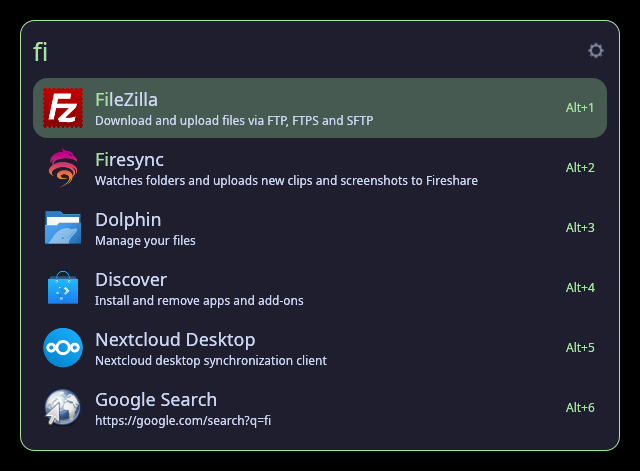
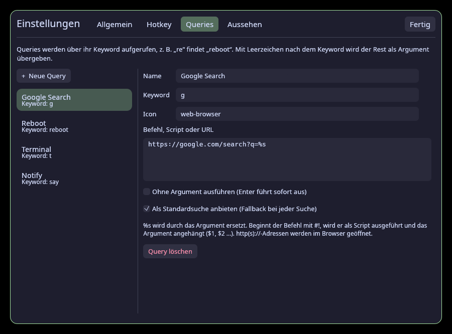
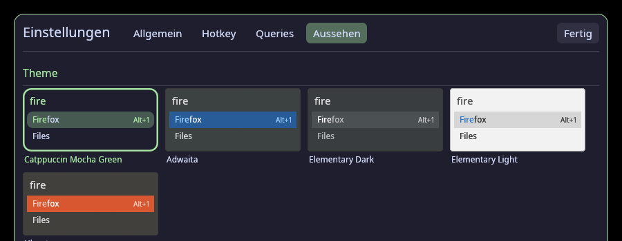
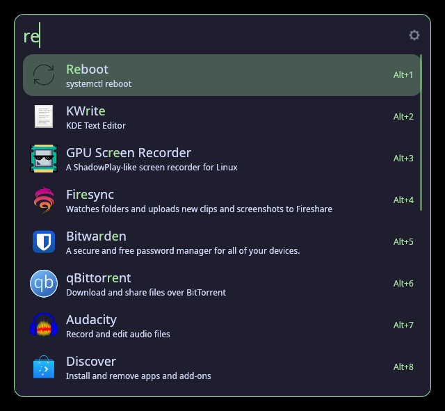

# rlauncher

A fast, Ulauncher-style application launcher for **Wayland**, written in Rust with [egui](https://github.com/emilk/egui).

Press a hotkey, type a few letters, hit Enter. rlauncher shows up in the middle of the screen, slightly above center, and lists the best matches as you type.

<p align="center">
  
</p>

## Features

- **App search**: finds every installed app (`.desktop` files, including Flatpak), with fuzzy matching ranked like Ulauncher and localized names. Apps you pick often move up.
- **Custom queries** (Ulauncher "shortcuts"): type `re` → *Reboot*, `g cats` → Google search for "cats". A query can run a command, a shell script (`#!/bin/sh …`) or open a URL. The `%s` placeholder takes the argument.
- **Ulauncher themes**: drop-in support for Ulauncher's `manifest.json` + GTK CSS themes, including `extend_theme`, `@define-color`, `alpha()`, `shade()` and `mix()`. Themes in `~/.config/ulauncher/user-themes` are picked up automatically.
- **Settings UI** behind the gear icon: hotkey recorder, autostart, query editor, and a theme picker with live preview.
- **Calculator**: `2*(3+4)`, `sqrt(2)^2`, `sin(pi/2)`. Enter copies the result.
- **File browser**: queries starting with `/` or `~` list files. Enter opens a file, Tab completes a folder.
- **Native Wayland**: wlr-layer-shell overlay, fractional scaling, and XDG activation, so launched apps really get focus. Clipboard support.
- **Global hotkey**: registered natively with KDE's kglobalaccel (with conflict detection), or through the XDG GlobalShortcuts portal. On any compositor you can also bind `rlauncher-toggle`.
- **Lightweight**: a small daemon that only creates its window while it is visible. Opening it is instant.
- On first start, settings, theme and shortcuts are **imported from Ulauncher**.

| Custom queries | Theme picker |
|---|---|
|  |  |

> The settings UI is currently in German.

## Compatibility

rlauncher needs a Wayland compositor that implements **wlr-layer-shell**.

| Desktop / compositor | Launcher | Global hotkey |
|---|---|---|
| KDE Plasma 6 | ✅ tested | ✅ built in (kglobalaccel), set in the settings |
| Hyprland | ✅ | via portal or `bind = SUPER, SPACE, exec, rlauncher-toggle` |
| Sway | ✅ | `bindsym $mod+space exec rlauncher-toggle` |
| niri | ✅ | `Mod+Space { spawn "rlauncher-toggle"; }` |
| COSMIC | ✅ | Settings → Keyboard → Custom shortcuts → `rlauncher-toggle` |
| river, Wayfire, labwc, … | ✅ | bind `rlauncher-toggle` |
| GNOME (Mutter) | ❌ no layer-shell | – |
| X11 | ❌ | – |

Only KDE Plasma 6 has been tested so far. The other layer-shell compositors should work but haven't been checked, so feedback is welcome.

Runtime requirements: `libxkbcommon` and a working Vulkan or OpenGL (EGL) driver. Prebuilt binaries are provided for **x86_64** and **aarch64** and need glibc ≥ 2.35. On other systems the installer builds from source.

## Installation

### One-liner

```sh
curl -fsSL https://raw.githubusercontent.com/wildesPepega/rlauncher/main/install.sh | sh
```

This installs `rlauncher` and `rlauncher-toggle` to `~/.local/bin`, adds an autostart entry and starts the daemon. Nothing is installed system-wide and no root is needed.

Installer options:

```sh
curl -fsSL https://raw.githubusercontent.com/wildesPepega/rlauncher/main/install.sh | sh -s -- --source        # build from source
curl -fsSL https://raw.githubusercontent.com/wildesPepega/rlauncher/main/install.sh | sh -s -- --no-autostart
curl -fsSL https://raw.githubusercontent.com/wildesPepega/rlauncher/main/install.sh | sh -s -- --uninstall
```

### From source

Requires Rust 1.88+ and the libxkbcommon development headers (`libxkbcommon-dev` / `libxkbcommon-devel`).

```sh
git clone https://github.com/wildesPepega/rlauncher
cd rlauncher
./install.sh --source
```

Or with cargo only: `cargo install --git https://github.com/wildesPepega/rlauncher`. In that case, start `rlauncher` yourself (e.g. from your compositor's autostart).

### Coming from Ulauncher

Quit Ulauncher and remove its autostart entry. If Ulauncher's toggle command still holds your hotkey (e.g. Meta+Space on KDE), rlauncher shows the conflict in *Settings → Hotkey* and can take the key over with one click.

## Usage

| Key | Action |
|---|---|
| type | search |
| ↑ / ↓, Ctrl+P / Ctrl+N, Ctrl+K / Ctrl+J | move the selection |
| Enter | run the selected item |
| Alt+Enter | alternative action (open the containing folder) |
| Alt+1 … Alt+9, Alt+a … | run item N directly |
| Tab | complete a folder or query keyword |
| Esc, or a click outside | close |

### Custom queries



Create and edit them in *Settings → Queries*, or edit `~/.config/rlauncher/shortcuts.json`. It uses the same format as Ulauncher, so you can copy that file over.

| Field | Meaning |
|---|---|
| Keyword | What you type, e.g. `reboot`. Typing a prefix (`re`) finds it as well. |
| Command | A shell command (`systemctl reboot`), a script starting with `#!`, or an `http(s)://` URL. |
| `%s` | Replaced by the argument: everything typed after `keyword `. Shell-quoted for commands, URL-encoded for URLs. |
| Run without argument | Enter runs the query right away instead of waiting for an argument. |
| Default search | Offered as a fallback for every search (e.g. "Google Search for …"). |

Without `%s`, the argument is appended to the command, so scripts receive it as `$1`, `$2`, …, just like in Ulauncher.

From the command line:

```sh
rlauncher shortcuts add yt "YouTube" "https://youtube.com/results?search_query=%s"
rlauncher shortcuts add up "System update" "kitty -e sudo pacman -Syu" --no-arg
rlauncher shortcuts list
rlauncher shortcuts remove yt
```

### Themes

Choose one in *Settings → Appearance*. rlauncher looks for themes in:

1. `~/.config/rlauncher/themes/`
2. extra folders you add in the settings (`theme_dirs` in the config)
3. `~/.config/ulauncher/user-themes/` (Ulauncher's user theme path)
4. `/usr/share/ulauncher/themes/`

The two themes `light` and `dark` are built in. Any Ulauncher theme (a folder with `manifest.json` and a CSS file) works. `rlauncher themes` lists all themes that were found.

## Command line

```
rlauncher                     start the daemon (hidden)
rlauncher toggle|show|hide    control the running daemon (starts it if needed)
rlauncher show <query>        open with a prefilled query, e.g. `rlauncher show ~/`
rlauncher settings [tab]      open the settings (general|hotkey|queries|appearance)
rlauncher reload | quit
rlauncher themes              list available themes
rlauncher shortcuts …         manage custom queries
rlauncher-toggle              tiny client meant for hotkey bindings
```

## Configuration

Everything can be changed in the settings UI. The files are:

| File | Content |
|---|---|
| `~/.config/rlauncher/config.toml` | settings, re-read every time the window opens |
| `~/.config/rlauncher/shortcuts.json` | custom queries (Ulauncher format) |
| `~/.local/share/rlauncher/stats.json` | launch statistics used for ranking |

```toml
theme = "Catppuccin-Mocha-Green"
theme_dirs = []            # extra theme folders
width = 600.0              # window width in logical pixels
max_results = 8            # visible results
top_offset = 0.22          # top edge at 22 % of the screen height
terminal = ""              # for Terminal=true apps, empty = auto-detect
close_on_focus_out = true
hotkey_enabled = true
hotkey = "LOGO+space"      # XDG shortcut syntax
calculator = true
file_browser = true
shadow = true
font = ""                  # path to a .ttf/.otf, empty = system sans-serif
jump_keys = "1234567890abcdefghijklmnopqrstuvwxyz"
```

## How it works

- `rlauncher` runs as a small **daemon** that owns a control socket at `$XDG_RUNTIME_DIR/rlauncher-<display>.sock`. `rlauncher-toggle` and `rlauncher show|hide|…` only write a command to that socket. If no daemon is running, they start one.
- When it is shown, the daemon creates a transparent **wlr-layer-shell overlay** covering the active output, with exclusive keyboard focus. The launcher window is drawn inside that overlay, horizontally centered and placed at `top_offset` of the screen height. This gives exact positioning, which normal Wayland windows can't do. A click outside the window closes it. When hidden, the surface is destroyed and nothing is rendered.
- The UI is rendered with **egui + wgpu** (Vulkan or GLES). Input goes through smithay-client-toolkit with xkbcommon (key repeat, compose and layouts). Fractional scaling uses `wp_fractional_scale_v1` + `wp_viewporter`.
- Before an app is started, rlauncher requests an **XDG activation token** from the compositor and passes it on as `XDG_ACTIVATION_TOKEN`, so the new window is allowed to take focus.
- The **hotkey** is registered with KDE's kglobalaccel over D-Bus when it is available. Otherwise the XDG GlobalShortcuts portal is used.
- **Apps** are read from all `applications/` folders in `XDG_DATA_DIRS` in a background thread every time the launcher opens. **Icons** are resolved from your icon theme (KDE, GNOME or GTK setting, with inheritance) and rasterized in a background thread (SVG via resvg).
- **Ranking** uses Ulauncher's algorithm (Levenshtein-based score with word-start boosts), filtered to plausible matches and boosted by how often and for which query you picked an item.

## Not supported (yet)

- Ulauncher extensions (Python)
- GNOME/Mutter and X11
- Translations (the settings UI is German)

## Uninstall

```sh
curl -fsSL https://raw.githubusercontent.com/wildesPepega/rlauncher/main/install.sh | sh -s -- --uninstall
```

To reset all settings as well, run `rm -rf ~/.config/rlauncher ~/.local/share/rlauncher`.

## License

MIT. Inspired by [Ulauncher](https://ulauncher.io), whose theme format and shortcut format rlauncher supports.
